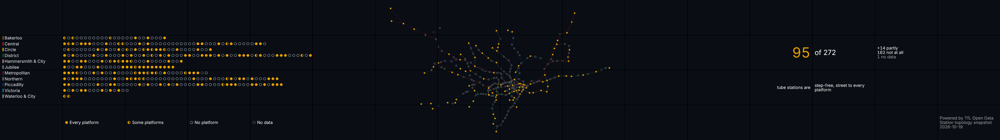
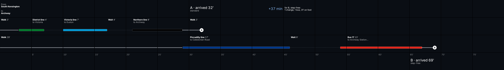
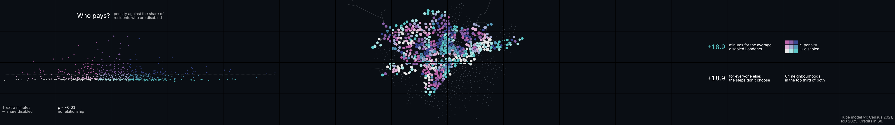
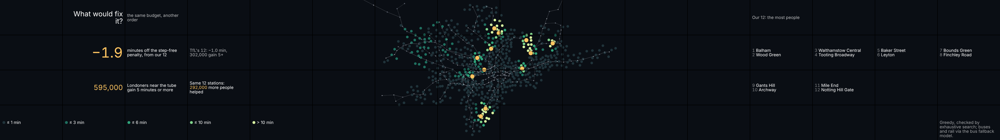

# Mind the Step: One network, two Londons

An interactive story for Imperial's Data Observatory (16 × 4 screens, 30720 × 4320 px), built on TfL Open Data. It asks how much longer London is for people who cannot use stairs, who pays for that, and what would fix it.



## The story

Framed as the DO Visualisation Toolkit asks.

- **Key message:** in London, how much a step costs you depends on where you live, not who you are. Spent differently, the same budget for new step-free stations would save almost twice as much time.
- **Audience:** Data Observatory visitors: students, researchers, and the people who plan and campaign for accessible transport.
- **Takeaway:** "step-free" on a map is not step-free in practice. The gap is measurable, it is concentrated in particular places, and it can be closed faster by choosing where to build with data.

The scenes follow the toolkit's five-part narrative:

| Part                | Scenes                                                     |
| ------------------- | ---------------------------------------------------------- |
| Problem and context | S0 Attract, S1 The Pulse, S2 The Step                      |
| Exploration         | S3 Two Londons, S6 The Race                                |
| Insight             | S4 Who Pays, S5 On Paper                                   |
| Implications        | S7 What Would Fix It (recommendations)                     |
| Future              | S8 Close: findings, and the open data and code to build on |

The layout follows the toolkit's design rules:

- **Central focal layout:** the key message sits in the centre zone (5 \| 6 \| 5 screens), with context and implications on either side.
- **Text size:** no text is smaller than 130 px, 3% of the 4,320 px canvas height. A unit test enforces it.
- **No text across a screen boundary:** checked for every scene and step by the browser tests.

## In two minutes

**What it finds**

|           | Finding                                                                                                         | Scene |
| --------- | --------------------------------------------------------------------------------------------------------------- | ----- |
| 95 of 272 | tube stations are step-free from street to platform                                                             | S2    |
| 42%       | of tube journeys start at a station with no step-free access                                                    | S1    |
| +19 min   | on the average tube journey for a step-free traveller                                                           | S4    |
| ρ = −0.01 | the penalty does not follow where disabled Londoners live; it follows where you live                            | S4    |
| 13 of 95  | step-free stations lost it at least once to a broken lift in two days of our own log                            | S5    |
| +87%      | more minutes saved by 12 stations chosen for the journeys people make than by TfL's 12, counting buses and rail | S7    |

**How to see it**

- **Online demo:** [ada-lc826.github.io/london-transport](https://ada-lc826.github.io/london-transport/). The simulator shows the whole wall plus two tablets: pick a scene on tablet A, press Next step, and make choices on tablet B.
- **Locally:** `vp install && vp run dev`, then open http://localhost:5780.
- **The 5-minute route:** S0 → S2 → S3 → S6 → S7 → S8. The full story, S0–S8, takes 8–9 minutes.



**The data science behind it.** Every figure on the wall is recomputed from open data by the Python pipeline in [`pipeline/`](pipeline/README.md), with its method written up in [`docs/methods/`](docs/methods/):

- **Step-free access:** computed footpath by footpath from TfL's station topology, and checked against known stations, TfL's 2024 upgrade list and TfL's lift records.
- **Network model:** a graph model of tube travel time, standard and step-free, calibrated to TfL Journey Planner journeys by alternating L1 linear programs. Leave-one-origin-out MAE is 3.3 min standard and 4.5 min step-free.
- **Spatial equity (S4):**
    - every London neighbourhood (MSOA) joined to Census 2021 disability and IoD 2025 deprivation;
    - Spearman correlations and an OLS with robust standard errors;
    - Moran's I, and LISA hot spots with FDR control.
- **Optimisation (S7):** greedy choice of the stations to upgrade, each pick re-evaluated on the model, and checked against exhaustive search. Trade-off curves weigh people, deprivation and disability.
- **Machine learning ([bus fallback](docs/methods/bus-fallback.md)):** LightGBM learns how much buses and other rail make up for the tube's steps, with spatial cross-validation (leave one origin out; leave one 5 km block out) and TreeSHAP. It corrects step-free times to within 6.6 min, against 20.4 for the tube alone. S7 uses it, so an upgrade only counts where it beats what buses and rail already offer.
- **Our own data:** TfL's lift disruptions logged every 15 minutes since 19 October 2026 by a scheduled GitHub Action, and replayed against the topology (S5).
- **Engineering:** 85 Python and 75 TypeScript unit tests, plus browser tests that check no text crosses a bezel. All run in CI.

Results are descriptive, not causal, and the models cover the tube only. Each method page ends with its limitations.





The research and design plan (in Chinese) is at [`docs/plan/mind-the-step-plan.zh-CN.md`](docs/plan/mind-the-step-plan.zh-CN.md). This repository is built on [`dsi-icl/do-starter-playground`](https://github.com/dsi-icl/do-starter-playground), with its upstream history kept: `git diff upstream/main...` shows everything added on top of it.

## Online demo

**https://ada-lc826.github.io/london-transport/** is a static build of the app, published by the [`deploy-pages`](.github/workflows/deploy-pages.yml) workflow on every change to `apps/website/` on `main`. GitHub Pages has no server, so the demo uses an in-browser bus ([`local-bus.ts`](apps/website/src/lib/realtime/local-bus.ts)) in place of the WebSocket one: pages in the same browser (the simulator's iframes, or `/world` and `/control` in separate tabs) stay in sync, but other devices do not. To build it locally:

```bash
cd apps/website && STATIC_DEMO=1 BASE_PATH=/london-transport/ vp build   # .output/public
```

## Running it

```bash
vp install
vp run dev        # http://localhost:5780
```

| Route                     | What it is                                                                                                                         |
| ------------------------- | ---------------------------------------------------------------------------------------------------------------------------------- |
| `/`                       | Simulator: the full 16×4 wall preview (or the 3×2 one-iframe-per-screen wall) plus two control tablets                             |
| `/screen?c=<col>&r=<row>` | One physical screen; the URL Vizzy Studio loads per wall node. Coordinates outside the wall show an error instead of being clamped |
| `/world`                  | The whole wall on one page and one WebGL context: preview, screen recording, Vizzy compatibility mode                              |
| `/control?operator=A`     | Presenter tablet: scene, step, play/pause, speaker notes with the figures on the wall, and wall health                             |
| `/control?operator=B`     | Traveller tablet: only the current scene's choices (S3's origin, S6's trip)                                                        |
| `/bus`                    | WebSocket bus. Owns scene state; answers binary clock pings                                                                        |

Query flags: `layout=mini` uses the 3×2 wall instead of 16×4; `m=dev` adds the debug overlay (bezels, 5|6|5 zones, eye-height band, and each screen's connection, clock offset and round trip); `bezels=0` hides the bezel lines in `/world`.

### How the wall stays in sync

- **Geometry** (`apps/website/src/wall/`): scenes lay out in wall pixels (30720 × 4320). Each screen draws only its own 1920 × 1080 rectangle and skips regions that do not touch it. Maps get a per-screen camera from one function, `cameraForRect`, which is unit-tested for continuity across every bezel and for agreement between `/screen` and `/world`. Text goes through `ScreenText`, which keeps it inside one screen.
- **Clock**: screens ping the bus every 2 s with binary frames that follow Vizzy Studio's opcodes (`CLOCK_PING 0x08`, `CLOCK_PONG 0x09`) and keep the offset from the fastest recent round trip.
- **Scenes**: control tablets send intents (`scene/goto`, `scene/step`, `scene/play`); the bus applies them and broadcasts `scene/state` with a revision number and a timeline anchor (position, server time, rate). Each screen works out the current position from its synchronised clock, so animations line up with no per-frame messages. Scene changes are rare, so the anchor travels as JSON rather than a binary frame.
- **Wall health**: each `/screen` reports its tile, scene revision and clock round trip every 5 s and on every scene change (`screen/report`). The bus sends tablets a summary at most once a second (`wall/health`); the presenter tablet shows it as a 16×4 grid: connected, drawing the current revision, clock error within one frame (±17 ms), and tiles opened twice.

## Scenes

| Scene                  | Steps | What it shows                                                                                                                                                                                                                                                                                                                                 |
| ---------------------- | ----- | --------------------------------------------------------------------------------------------------------------------------------------------------------------------------------------------------------------------------------------------------------------------------------------------------------------------------------------------- |
| S0 · Attract           | 1     | Title across the centre bezel                                                                                                                                                                                                                                                                                                                 |
| S1 · The Pulse         | 2     | One weekday on TfL's railways in 48 seconds: people on the network across the top row, each tube line's boarders, the map swelling with load, the busiest links; then stations with no step-free access, and the 42% of tube journeys that start at one. Method: [`docs/methods/demand.md`](docs/methods/demand.md)                           |
| S2 · The Step          | 3     | Every tube station by street-to-platform step-free access: the network, the reveal (95 of 272 fully step-free), then South Kensington. Method and validation: [`docs/methods/step-free-access.md`](docs/methods/step-free-access.md)                                                                                                          |
| S3 · Two Londons       | 2     | From one of 12 origins (chosen on the tablet), every tube station by Journey Planner travel time, standard beside step-free, then the median extra minutes and the biggest gaps. Method: [`docs/methods/travel-times.md`](docs/methods/travel-times.md)                                                                                       |
| S4 · Who Pays          | 3     | Every London neighbourhood near the tube by how much longer its tube journeys take step-free (minutes or share of the tube lost, chosen on the tablet), boroughs ranked; then the penalty against disability share, which shows none of the expected link; then where it clusters. Method: [`docs/methods/equity.md`](docs/methods/equity.md) |
| S6 · The Race          | 3     | One of 9 trips (chosen on the tablet), raced leg by leg along the wall at 5 minutes a column: A on the fastest route, B on the fastest step-free one, then the gap. Journeys: [`docs/methods/travel-times.md`](docs/methods/travel-times.md#s6-the-race)                                                                                      |
| S5 · On Paper          | 2     | Step-free on paper against step-free in practice: the 95 fully step-free stations against those still step-free at the latest sample of our lift log, the stations cut off and TfL's message for each; then the whole log replayed. Method: [`docs/methods/lifts.md`](docs/methods/lifts.md)                                                  |
| S7 · What Would Fix It | 3     | A decision theatre: TfL's 12 stations to be made step-free next and what they would save; our 5–20 stations for the same budget, putting first the most people, the most deprived or disabled residents (chosen on the tablet); then the trade-off and the overlap. Method: [`docs/methods/upgrades.md`](docs/methods/upgrades.md)            |
| S8 · Close             | 2     | One figure from each scene, each computed from that scene's own data; then how it was done, every data source with its credit, and a QR code to this repository.                                                                                                                                                                              |
| Calibration            | 1     | Test card for checking a real wall                                                                                                                                                                                                                                                                                                            |
| Map check              | 1     | Whole-wall basemap driven by the tablets                                                                                                                                                                                                                                                                                                      |

## Data pipeline

`pipeline/` is a Python ([uv](https://docs.astral.sh/uv/)) project. Jobs that call the TfL API write to the `data` branch: the lift-status logger (every 15 minutes, building a lift-reliability dataset), the network snapshot, and the Journey Planner batches. See [`pipeline/README.md`](pipeline/README.md).

Method notes, with results and limitations:

- [Step-free access](docs/methods/step-free-access.md): street to platform for every tube station, from TfL's topology, checked against TfL's published topology files.
- [Travel times](docs/methods/travel-times.md): standard and step-free Journey Planner times from 12 origins.
- [Demand](docs/methods/demand.md): a typical weekday from TfL's NUMBAT model (S1).
- [Lifts](docs/methods/lifts.md): stations cut off by lift outages, from our 15-minute lift log (S5).
- [Equity](docs/methods/equity.md): the step-free penalty by London neighbourhood against Census 2021 disability and IoD 2025 (S4).
- [Upgrades](docs/methods/upgrades.md): which stations to make step-free next, against TfL's list (S7).
- [Bus fallback](docs/methods/bus-fallback.md): a LightGBM model of how much buses and other rail make up for the tube's steps, validated leaving one origin or one 5 km block out (MAE 6.6 / 5.5 min against 20.4 for the tube alone).
- [Network model](docs/methods/network-model.md): a tube-and-walk graph model calibrated to those times (leave-one-origin-out MAE 3.3 min standard, 4.5 min step-free).

Powered by TfL Open Data.

---

# Starter notes: DO App Kit

A starter for creating DO custom applications.

This starter repo is built with Vite+.

## Data and attribution

The same list is shown on the wall at the end of S8 (`apps/website/src/data/attribution.ts`); keep the two in step.

- **Transport for London**: Unified API, Journey Planner, station topology, NUMBAT demand, lift disruptions. Powered by TfL Open Data. Contains OS data © Crown copyright and database rights 2016 and Geomni UK Map data © and database rights [2019].
- **Office for National Statistics**: Census 2021 TS038 and TS007A (via Nomis); MSOA population weighted centroids. Source: Office for National Statistics licensed under the Open Government Licence v3.0. Contains National Statistics data © Crown copyright and database right 2025; contains OS data © Crown copyright and database right 2025.
- **Department for Transport**: NaPTAN, the national register of bus stops. Contains public sector information licensed under the Open Government Licence v3.0.
- **Ministry of Housing, Communities and Local Government**: English Indices of Deprivation 2025. Contains public sector information licensed under the Open Government Licence v3.0.

S8's QR code (`apps/website/public/qr-repo.svg`) links to this repository. If the repository moves, regenerate it (for example with Python's `segno`, error level M), keeping black modules on white, the 4-module quiet zone, and a `viewBox` in place of a fixed size so the wall can scale it.

## Runtime Context Note (Top-Level vs Iframe)

Data Observatory deployments may render an app either:

- as a top-level document, or
- inside one or more iframes (for multi-screen orchestration/simulation).

This matters for graphics-heavy features: iframe-based deployments can increase pressure on
browser/GPU context limits (especially with WebGL). For that reason, this example includes
runtime-aware rendering decisions and fallback strategies so behavior remains stable in both modes.

## Stack Used In This Example

The example app in `apps/website` focuses on three package groups:

- `@tanstack/react-router`: file-based routing and route-level app structure (`/`, `/control`, `/screen`, `/bus`).
- `@tanstack/pacer`: throttling of high-frequency control events before broadcast (for example slider updates).
- Mapping stack:
  `maplibre-gl`, `@vis.gl/react-maplibre`, `@deck.gl/core`, `@deck.gl/layers`, `@deck.gl/react`.
  These are used to render the map, draw animated paths/markers, and support both richer and iframe-safe rendering paths. We strongly recommend the use of Deck.GL with MapLibre as the DO natively supports them.
- `vite-plus` (`vp`): monorepo task runner/repo manager used for project commands (`vp run dev`, `vp run build -r`, etc.).

## Development

- Check everything is ready:

```bash
vp run ready
```

- Run the tests:

```bash
vp run test -r
```

- Run the browser tests (Playwright, against the production build): every scene, step and tablet choice drawn on the 16×4 wall with no text crossing a bezel or cut off, and the realtime path from tablets to screens:

```bash
cd apps/website && vp build && npx playwright test
```

- Build the monorepo:

```bash
vp run build -r
```

- Run the development server:

```bash
vp run dev
```
